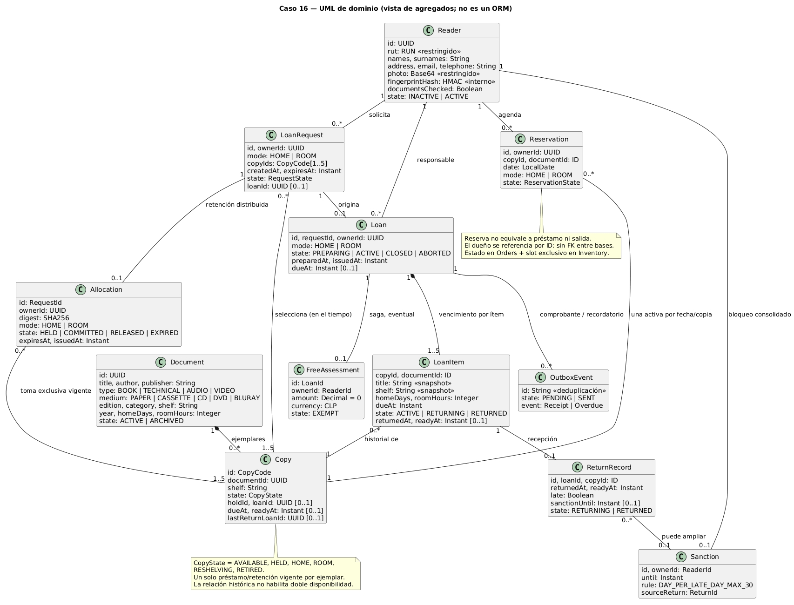
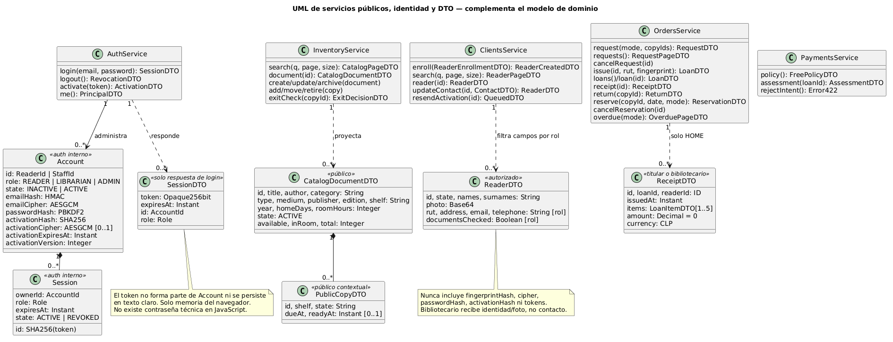
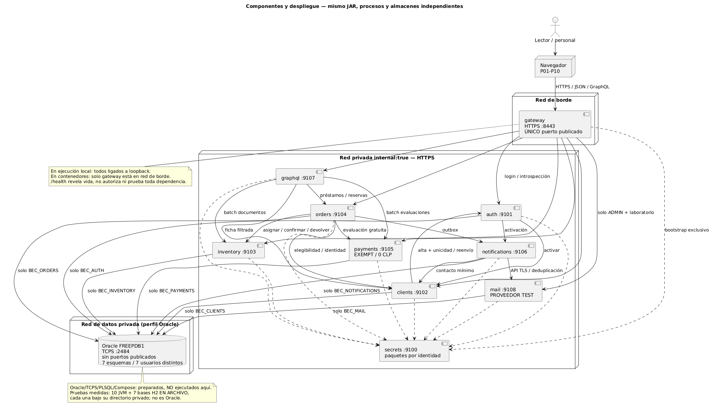
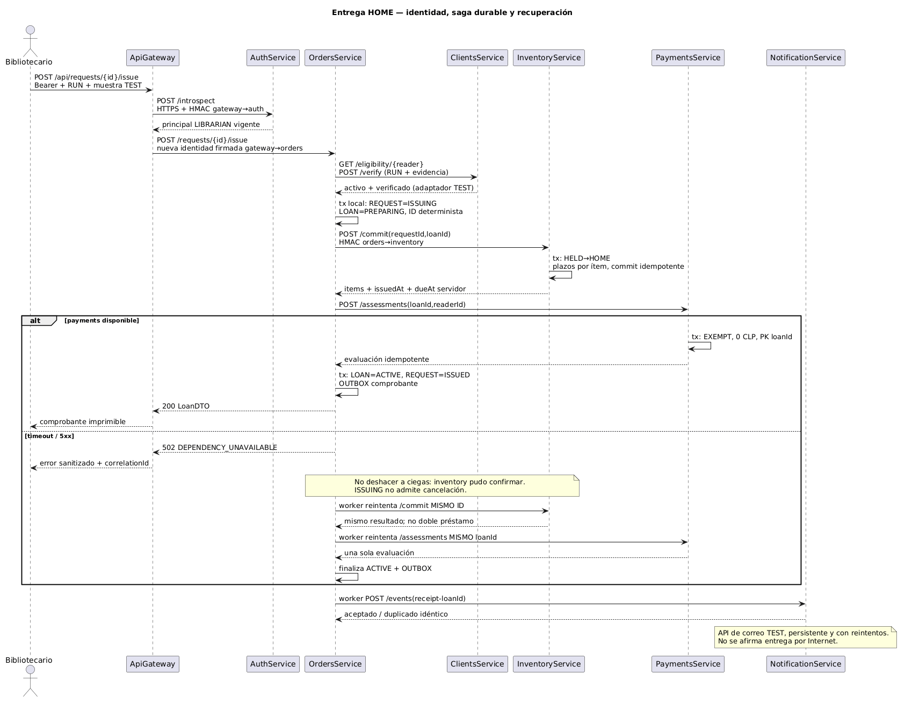
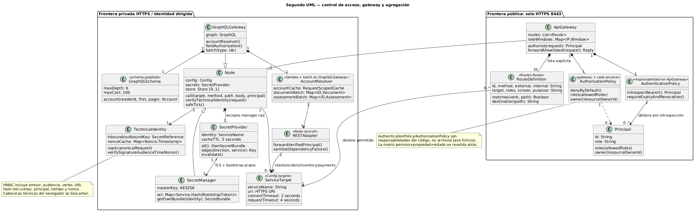
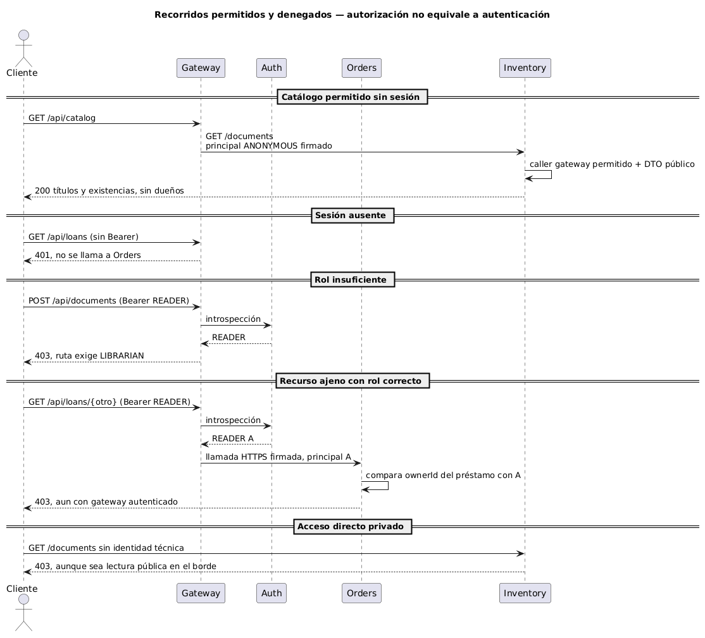
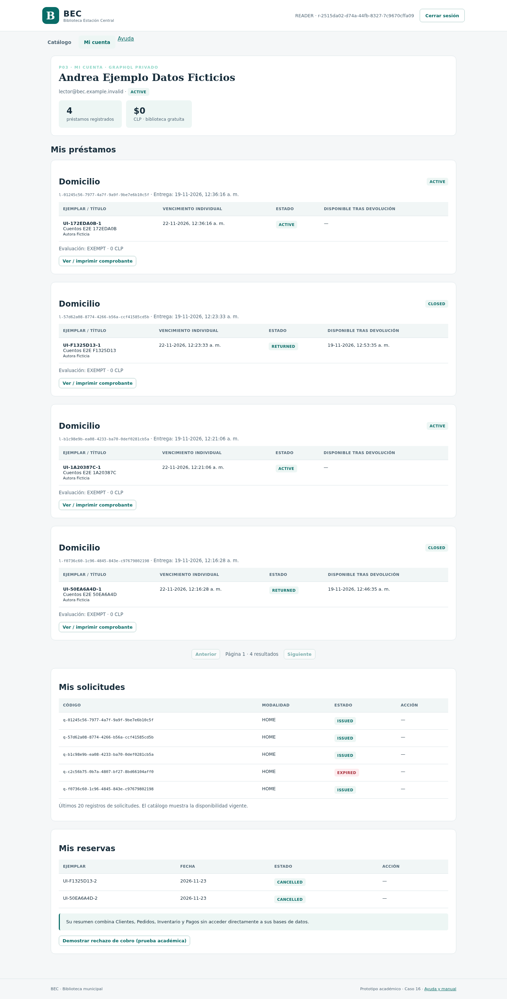

# Sistema de Préstamo · Biblioteca Municipal BEC

## Informe de desarrollo backend — Caso 16

**Asignatura:** [completar]  
**Docente:** [completar]  
**Integrantes y sección:** [completar; no fueron proporcionados]  
**Versión:** 1.0.0 · **Fecha de generación:** 19-11-2026 (UTC)

**Base documental:** `Tarea_parte_Backend.pdf`, `Caso16.docx` y `material_clases/`. Se respeta el caso de Biblioteca Municipal de Estación Central. El documento se llama Caso16, aunque un párrafo interno menciona “Caso 11”; se conserva Caso 16 como identificador de la entrega.

## Resumen y estado verificable

Se implementó una aplicación web nueva, no una ampliación de un frontend recibido. Java 21 orientado a objetos, capas de interfaz/negocio/repositorio, REST, gateway HTTPS, identidad técnica entre servicios, BFF GraphQL privado y persistencia separada. Inventario, pedidos/préstamos, clientes y pagos son procesos independientes, no módulos presentados como microservicios.

| Entregable o condición | Estado y evidencia |
|---|---|
| Backend y seguridad | **23 pruebas aprobadas**, cero fallas/errores/omitidas; `evidencias/pruebas_backend.json` y `junit-limpio.xml` |
| Frontend real | **13 comprobaciones aprobadas**, cero errores JavaScript; `evidencias/interfaz.json`, capturas P01–P10 |
| Carga | Seis escenarios REST/GraphQL HTTPS medidos; `evidencias/carga.json`, módulo 9 |
| Oracle obligatorio | Código JDBC, migraciones, procedimientos y despliegue TCPS **preparados, NO EJECUTADOS**; Docker no disponible en este WSL |
| Correo y dispositivos | API de correo TEST y verificación de muestra/antirrobo software; **sin envío Internet, SDK biométrico ni RFID físico** |
| Usabilidad institucional | Responsive verificado; aprendizaje <4 h y error humano <1 % **pendientes de estudio con personas** |

El cumplimiento es una **demostración académica probada en H2 en archivo**, no una certificación completa del caso en Oracle ni una autorización de producción. Los anexos forman parte de la entrega; no se reemplazan pruebas pendientes por afirmaciones.

### Índice de lectura y fuentes editables

1. Contratos y acciones del frontend.
2. UML de dominio, servicios públicos y DTO.
3. Microservicios, propiedad de datos y colaboración.
4. Stakeholders y matriz de autorización.
5. Segundo UML: gateway, políticas y confianza.
6. Publicación, protocolos y credenciales.
7. Información sensible y seguridad comprobada.
8. Servicios privados y agregación GraphQL.
9. Spikes, analítica, gRPC y decisiones.
10. Implementación, pruebas y trazabilidad final.

**Anexos:** A `contratos.md/.pdf`, `openapi.json`; B `contratos_privados.md`; C `seguridad_operacion.md`; D `matriz_acceso.csv`, `rutas_y_credenciales.csv`, `trazabilidad.csv`; E `diagramas.pdf` y seis fuentes `.puml/.svg/.png`; F cuatro ADR; G `validacion_oracle.md`; H `manual_usuario.pdf` y ayuda web. PDF y DOCX de este informe se generan desde este texto y resultados registrados.

# Módulo 1 · Acciones y contratos del frontend

## 1.1 Alcance de negocio y pantallas

El catálogo contiene libros, documentos técnicos y soportes multimedia, no streaming de audio/video. El administrativo registra y controla morosidad; el bibliotecario mantiene colección y entrega/recibe; el lector activo solicita y reserva. El catálogo del kiosco no exige sesión. La identificación de una persona no se deduce de un `readerId` enviado por el navegador.

| Pantalla | Usuario y acciones reales | Servicios |
|---|---|---|
| P01 Catálogo/kiosco | Anónimo busca por título, autor o categoría, ve disponibilidad y ejemplares en sala; lector solicita HOME/ROOM y reserva copia/fecha | S05–S06, S17, S25 |
| P02 Acceso/activación | Iniciar/cerrar sesión, activar por enlace y consultar identidad | S01–S04 |
| P03 Mi cuenta | Resumen GraphQL, préstamos/solicitudes/reservas, cancelar pendientes y ver gratuidad; botón TEST de cobro manipulado | S18–S19, S21–S22, S26–S27, S29–S32 |
| P04 Colección | Bibliotecario crea/edita/archiva documentos, incorpora/mueve/retira ejemplares | S07–S12 |
| P05 Fichas | Administrativo inscribe, verifica documentos, busca, actualiza contacto/foto y reenvía activación; ficha por alcance | S13–S16, S35 |
| P06 Preparación/entrega | Bibliotecario ve cola y ubicación, ficha/foto, comprueba RUN y muestra TEST, entrega | S15, S18–S22, S26 |
| P07 Devolución/salida | Bibliotecario devuelve por código y ve disponibilidad futura; control software de salida | S24, S33 |
| P08 Morosidad | Administrativo consulta HOME/ROOM y abre contacto para exigir devolución | S15, S28 |
| P09 Comprobante | Lector titular/bibliotecario ve e imprime HOME, con vencimiento por ítem | S23 |
| P10 Correo TEST | Administrativo inspecciona bandeja del adaptador solo en laboratorio | S34 |

## 1.2 Inventario completo de operaciones

Los siguientes identificadores se toman de `Routes.ALL`, la misma allowlist usada por el gateway. El detalle íntegro de **cada operación** —campos/tipos, obligatoriedad, validación, clasificación, entrada y salida JSON ficticias, errores, rol, propiedad, estado y destino— está en el Anexo A. OpenAPI permite importar los contratos en un cliente HTTP.

| ID | Verbo y ruta externa | Destino | Rol/pantalla |
| --- | --- | --- | --- |
| S01 | POST `/api/auth/login` | auth | PUBLIC · P02 |
| S02 | POST `/api/auth/logout` | auth | READER,LIBRARIAN,ADMIN · P02 |
| S03 | POST `/api/auth/activate` | auth | PUBLIC · P02 |
| S04 | GET `/api/auth/me` | auth | READER,LIBRARIAN,ADMIN · P02 |
| S05 | GET `/api/catalog` | inventory | PUBLIC · P01 |
| S06 | GET `/api/catalog/{id}` | inventory | PUBLIC · P01 |
| S07 | POST `/api/documents` | inventory | LIBRARIAN · P04 |
| S08 | PUT `/api/documents/{id}` | inventory | LIBRARIAN · P04 |
| S09 | DELETE `/api/documents/{id}` | inventory | LIBRARIAN · P04 |
| S10 | POST `/api/documents/{id}/copies` | inventory | LIBRARIAN · P04 |
| S11 | PUT `/api/copies/{id}` | inventory | LIBRARIAN · P04 |
| S12 | DELETE `/api/copies/{id}` | inventory | LIBRARIAN · P04 |
| S13 | POST `/api/readers` | clients | ADMIN · P05 |
| S14 | GET `/api/readers` | clients | ADMIN · P05 |
| S15 | GET `/api/readers/{id}` | clients | READER,LIBRARIAN,ADMIN · P05 |
| S16 | PUT `/api/readers/{id}` | clients | ADMIN · P05 |
| S17 | POST `/api/requests` | orders | READER · P01 |
| S18 | GET `/api/requests` | orders | READER,LIBRARIAN · P03,P06 |
| S19 | DELETE `/api/requests/{id}` | orders | READER,LIBRARIAN · P03,P06 |
| S20 | POST `/api/requests/{id}/issue` | orders | LIBRARIAN · P06 |
| S21 | GET `/api/loans` | orders | READER,LIBRARIAN,ADMIN · P03,P06 |
| S22 | GET `/api/loans/{id}` | orders | READER,LIBRARIAN,ADMIN · P03,P06 |
| S23 | GET `/api/loans/{id}/receipt` | orders | READER,LIBRARIAN · P09 |
| S24 | POST `/api/returns` | orders | LIBRARIAN · P07 |
| S25 | POST `/api/reservations` | orders | READER · P01 |
| S26 | GET `/api/reservations` | orders | READER,LIBRARIAN · P03,P06 |
| S27 | DELETE `/api/reservations/{id}` | orders | READER,LIBRARIAN · P03,P06 |
| S28 | GET `/api/overdue` | orders | ADMIN · P08 |
| S29 | GET `/api/payments/policy` | payments | PUBLIC · P03 |
| S30 | GET `/api/payments/assessments/{id}` | payments | READER,LIBRARIAN,ADMIN · P03 |
| S31 | POST `/api/payments/intents` | payments | READER · P03 |
| S32 | POST `/api/graphql` | graphql | READER,LIBRARIAN,ADMIN · P03 |
| S33 | GET `/api/exit-check/{id}` | inventory | LIBRARIAN · P07 |
| S34 | GET `/api/lab/mailbox` | mail | ADMIN · P10 |
| S35 | POST `/api/readers/{id}/activation` | clients | ADMIN · P05 |

**CRUD pertinente:** documentos y ejemplares permiten alta, lectura, actualización y baja lógica. Solicitudes/reservas permiten creación, consulta y cancelación condicionada, no edición arbitraria. Préstamos, devoluciones y sanciones no se borran para “hacer CRUD”; son transiciones auditables. La ficha actualiza contacto/foto, no cambia silenciosamente RUN, correo validado o biometría. Pagos mantiene evaluaciones de gratuidad, no un carrito comercial inventado.

## 1.3 Convenciones de contrato

- JSON UTF-8; `Content-Type: application/json` cuando hay cuerpo. Campos desconocidos, tipos incorrectos, repetidos en query y valores fuera de rango: 400. Cuerpo máximo 256 KiB (413), URI 2048 (414), formato no JSON (415).
- Identificadores de ruta: `[A-Za-z0-9_-]{1,100}`; códigos de ejemplar definidos por el contrato de alta. RUN se valida con módulo 11; email normalizado y único; fotos PNG/JPEG con tamaño y dimensiones limitados.
- Fechas de reserva `AAAA-MM-DD`, instantes UTC ISO-8601; reglas por día usan `America/Santiago`. El cliente **no fija** vencimiento, sanción, propietario, estado ni monto.
- Listas paginadas: `page` 0–1000, `size` 1–20; GraphQL usa `first` 1–20. Sin sesión: 401; rol/titularidad/identidad técnica insuficiente: 403; no encontrado: 404; conflicto de estado/stock/idempotencia: 409; cobro incompatible: 422; límite: 429; dependencia: 502; secretos/persistencia: 503.
- `Idempotency-Key` 8–80 caracteres `[A-Za-z0-9_-]`, obligatorio al solicitar, reservar y devolver. Misma clave con otro cuerpo: 409; reintento idéntico recupera el resultado. La entrega se deduplica por solicitud.
- Errores incluyen código estable, mensaje saneado y `correlationId`; nunca una excepción SQL, contraseña, plantilla o secreto. GraphQL puede responder HTTP 200 con `errors` y datos parciales: se comprueban ambos.

Todos los ejemplos son ficticios (`*.example.invalid`), no credenciales preinstaladas. Contraseñas del laboratorio se generan aleatoriamente fuera de fuentes.

# Módulo 2 · UML de dominio y servicios públicos

## 2.1 Modelo y separación de representaciones



La fuente editable es `diagramas/01_dominio.puml`; el SVG y el PDF A3 permiten leer todos los atributos y cardinalidades. Es un **modelo de agregados de negocio**, no un diagrama que prometa una tabla relacional por clase.

| Asociación y cardinalidad en ambos extremos | Justificación |
|---|---|
| Document `1` — Copy `0..*`; cada Copy pertenece a `1` Document | Una obra puede registrarse antes de incorporar copias; cada copia tiene código y ubicación propios |
| Reader `1` — LoanRequest `0..*`; solicitud tiene `1` titular | Permite historial y control de propiedad sin compartir la ficha completa |
| LoanRequest `1` — Allocation `0..1`; asignación referencia `1` solicitud | Puede existir una intención durable aún sin stock confirmado; inventario es la autoridad de la asignación |
| Allocation `1` — Copy `1..5`; Copy tiene `0..1` asignación HELD vigente | No hay doble asignación simultánea; el histórico no equivale a ocupación actual |
| LoanRequest `1` — Loan `0..1`; Loan proviene de `1` solicitud | La entrega idempotente no crea préstamos duplicados |
| Reader `1` — Loan `0..*`; Loan tiene `1` titular | Titularidad y sanciones pertenecen al lector autenticado |
| Loan `1` contiene LoanItem `1..5`; cada ítem tiene `1` préstamo | Plazo y devolución por documento, no una fecha general incorrecta |
| Copy `1` — LoanItem `0..*` históricos; ítem identifica `1` Copy | Una copia se reutiliza en el tiempo; solo un préstamo/hold vigente |
| Reader `1` — Reservation `0..*`; reserva tiene `1` lector y `1` copia | Unicidad de copia/día y dueño; no reserva genérica de título |
| LoanItem `1` — ReturnRecord `0..1`; devolución tiene `1` ítem | Reintentos no suman sanciones ni duplican reingreso |
| Reader `1` — Sanction `0..1` agregado vigente; sanción referencia `1` lector | Se mantiene hasta máxima fecha calculada; los hechos originales siguen en devoluciones |
| Loan `1` — FreeAssessment `0..1`; evaluación pertenece a `1` Loan | Puede faltar durante PREPARING; antes de ACTIVE se confirma una exención persistente |
| Loan `1` — OutboxEvent `0..*`; evento refiere `0..1` préstamo | Activación refiere lector, recordatorio/recibo refieren préstamo |

Las referencias entre servicios son IDs o snapshots verificados por API, **no claves foráneas ni JOIN entre esquemas**. Las asociaciones históricas no autorizan acceso a recursos ajenos. Document/Copy y préstamo/ítems tienen estados explícitos; no se calcula stock en JavaScript.

## 2.2 Servicios públicos y DTO



`diagramas/02_servicios_dto.puml` incluye operaciones públicas y atributos/tipos de DTO. Las firmas son contratos de aplicación; la implementación concreta utiliza `Map<String,Object>` con validación explícita, no se afirman clases DTO Java inexistentes.

| Servicio/clase | Operaciones públicas | Representación externa frente a datos internos |
|---|---|---|
| AuthService | S01–S04 | Devuelve sesión/rol/expiración; no hash de contraseña ni registro interno de sesión |
| InventoryService | S05–S12, S33 | Catálogo y copias con conteos; omite titular, hold y claves; edición requiere bibliotecario |
| ClientsService | S13–S16, S35 | Admin/titular acceden a ficha; bibliotecario solo identidad/foto; nunca hash de muestra ni contraseña |
| OrdersService | S17–S28 | Solicitud, préstamo, ítems, reserva, recibo y morosidad por alcance; no cabeceras de firma ni claves de dedup |
| PaymentsService | S29–S31 | Política pública y evaluación 0 CLP por titular; el estado PAID enviado no tiene efecto |
| GraphQLGateway | S32 | Proyección agregada de lectura con autorización por campo/recurso |
| MailTestProvider | S34 | Mensajes solo ADMIN/LAB; no bandeja pública ni envío Internet |

La consulta del catálogo no devuelve `Account`, `Session`, biometría ni contenido privado del préstamo. Los snapshots de título y plazo conservan el comprobante aunque se edite después el documento.

# Módulo 3 · Microservicios, propiedad y colaboración

## 3.1 Componentes y despliegue



Un mismo JAR se ejecuta con diferente nombre/configuración en **diez procesos independientes**: gateway, secrets, auth, clients, inventory, orders, payments, graphql, notifications y mail. El código compartido no crea acceso cruzado a BD. El lanzador local y Docker separan los procesos; las pruebas de integración arrancan diez servidores reales TLS en una JVM de pruebas para poder inyectar reloj y caídas deterministas.

| Componente | Autoridad/datos propios | Dependencias por contrato |
|---|---|---|
| auth | Cuentas, hashes, activación, sesiones revocables | clients para activar; notifications para outbox |
| clients | Ficha cifrada, índices RUN/email HMAC, muestra TEST protegida | auth para unicidad/provisión/reenvío |
| inventory | Obras, copias, asignaciones, calendario autoritativo de reserva | No necesita BD ajena |
| orders | Solicitudes, préstamos/ítems, reservas del lector, devoluciones, sanción, idempotencia, outbox | clients, inventory, payments, notifications |
| payments | Política de gratuidad y evaluación EXEMPT por préstamo | No banco/proveedor comercial |
| notifications | Eventos deduplicados, intentos y estado de entrega | clients para contacto mínimo; mail para envío TEST |
| mail | Mensaje TEST cifrado y deduplicación del proveedor | Sin SMTP/Internet |
| graphql | Sin BD; proyección por request | clients + orders + inventory + payments |
| gateway | Sin BD de negocio; catálogo de rutas y límites en memoria | auth y destino explícito |
| secrets | Bundles cifrados/ACL por consumidor, fuera de BD de negocio | Archivos privados y su clave raíz de arranque |

Hay **siete repositorios persistentes**. Perfil principal preparado: siete esquemas/credenciales Oracle en un servidor, sin acceso cruzado. Perfil probado: siete archivos H2 separados. Oracle compartido sigue siendo una dependencia física común, no siete servidores independientes.

## 3.2 Identidad y fallas

| Llamada | Propósito y autorización adicional | Si falla |
|---|---|---|
| gateway → auth | Introspección de sesión en cada operación protegida | 401 si inválida; 502 si auth no responde; no identidad “de respaldo” |
| gateway → servicio | Ruta/verbo permitidos, rol verificado y principal firmado nuevo | 502 saneado; no se redirige a rutas alternativas |
| clients → auth | Comprobar email, provisionar cuenta y reenvío ADMIN | Precheck fallido impide alta; alta ya persistida reintenta provisión |
| auth → clients | Activar la ficha con token válido de un uso | No marca cuenta ACTIVE hasta confirmar; reintento de activación es seguro |
| orders → clients | Lector activo y verificación RUN/muestra bajo bibliotecario | No entrega con identidad no comprobada |
| orders → inventory | Asignar todo o nada, confirmar, reservar, liberar/devolver | Intención durable ALLOCATING/ISSUING/RETURNING/CANCELLING y reintento; no se inventa stock |
| orders → payments | Crear una evaluación de gratuidad por préstamo | PREPARING; al recuperar se completa la misma entrega, no otra |
| auth/orders → notifications | Evento durable con ID/digest | Outbox retiene pendiente; dedup evita doble correo |
| notifications → clients/mail | Contacto mínimo y envío TEST | Reintentos exponenciales hasta 256 s entre intentos; sin marcar entregado antes de confirmación |
| graphql → cuatro fuentes | Lecturas acotadas con usuario verificado | Fuente de campo opcional caída: `errors` + campo null; raíz requerida caída: error sin inventar datos |
| cualquier consumidor → secrets | Solo su bundle mediante token propio | Caché máxima 5 s; vencida y sin gestor: 503/fail-closed |

Las claves HMAC son por **arista dirigida**, no un secreto global. El receptor vuelve a comprobar caller autorizado, rol, propiedad, estado y cuerpo. Una firma técnicamente válida no autoriza cualquier operación.

## 3.3 Colaboración representativa y consistencia



1. Lector activo y sin sanción/vencido crea una solicitud con clave de idempotencia; orders persiste intención y inventory asigna 1–5 copias en una transacción local.
2. Bibliotecario verifica al titular con RUN y muestra TEST. Orders persiste `ISSUING`/préstamo `PREPARING` antes de confirmar stock.
3. Inventory confirma HOME/ROOM y calcula vencimientos con el reloj servidor y la política del documento. Payments crea una única evaluación EXEMPT.
4. Orders confirma ACTIVE/ISSUED y outbox del recibo HOME en su propia transacción. Notifications envía por la API TEST.
5. Una caída tras confirmar inventory deja un estado intermedio recuperable; el worker reintenta con el mismo ID. Cancelar en resultado incierto está prohibido.

No hay transacción ACID distribuida ni promesa de “exactly once” de red. Hay transacciones locales, estados durables, reintentos y efectos idempotentes. Las pruebas T13/T14/T16 comprueban recuperación y no duplicación.

# Módulo 4 · Stakeholders y matriz de autorización

## 4.1 Interesados no equivalen a usuarios

| Stakeholder | Interés/impacto | ¿Rol operativo? |
|---|---|---|
| Lector registrado | Disponibilidad, privacidad, plazos, recibos y sanciones justas | READER, únicamente recursos propios |
| Visitante de kiosco | Buscar sin inscripción ni exposición de terceros | Anónimo, catálogo/política y acceso/activación |
| Bibliotecario | Colección, preparación, identificación, circulación y salida | LIBRARIAN; no administra fichas completas ni morosidad administrativa |
| Administrativo | Documentación de inscripción, activación/contacto y morosos | ADMIN; no recibe automáticamente permisos de bibliotecario |
| Dirección de biblioteca | Continuidad, normas de sanción, aprobación de reglas | Sin cuenta privilegiada inventada; gobernanza |
| Municipalidad/financiador | Uso responsable de recursos, legitimidad del servicio | Sin acceso operativo ni analítica identificable por defecto |
| Lectores menores/representantes y comunidad | Accesibilidad, equidad, protección de datos | No nuevo rol técnico sin requisito/procedimiento aprobado |
| Operación TI/seguridad | Certificados, respaldo, secretos, disponibilidad | Identidad técnica, no rol funcional para consultar lectores |
| Proveedor de correo/dispositivos | Entrega/identificación y contrato mínimo | Consumidor/proveedor técnico acotado; adaptadores TEST en esta entrega |

El control deriva del caso y del mínimo privilegio, no de que alguien sea un stakeholder poderoso. ADMIN significa administrativo, no superusuario universal.

## 4.2 Matriz completa

`matriz_acceso.csv` contiene **116 filas**: cada una de las 29 rutas publicadas cruzada con GET, POST, PUT y DELETE. Distingue **PERMITIDO**, **DENEGADO** y **N/A (405, operación inexistente)** para anónimo, lector, bibliotecario y administrativo, e incluye propietario, estado y punto de control. No se deduce permiso por ausencia de una fila.

- PUBLIC: S01, S03, S05, S06, S29; presentar un bearer inválido tampoco concede acceso.
- READER: solicitudes/reservas propias, préstamos/ficha/evaluaciones propios y cuenta propia. No puede pasar otro `readerId` para convertirse en ese lector.
- LIBRARIAN: colección, cola/entrega, devoluciones, recibos, ficha limitada y simulación de salida. No inscripción ni listado administrativo de morosos.
- ADMIN: fichas completas, reenvío de activación, morosidad, consultas autorizadas y bandeja TEST. No entrega/devolución/mutación de colección.

**Dónde se aplica:** gateway identifica ruta/verbo y valida sesión/rol; el receptor verifica caller técnico, rol y reglas del recurso; GraphQL controla además campos privados. Ocultar un botón solo mejora UX, nunca sustituye estos controles.

**DELETE no significa borrar historia:** archiva obra/copia disponible, cancela pendiente/reserva vigente; préstamos emitidos, devoluciones y sanciones no tienen DELETE publicado.

# Módulo 5 · Segundo UML: gateway y seguridad



`diagramas/03_gateway_seguridad.puml` muestra atributos, operaciones, cardinalidades y fronteras. AuthenticationPolicy y AuthorizationPolicy son **responsabilidades del diseño** implementadas en ApiGateway, Principal y validadores del servicio; no se presentan como archivos Java separados inexistentes.

| Elemento | Responsabilidad concreta |
|---|---|
| ApiGateway | Publica UI/35 rutas explícitas, limita, introspecta sesión, transforma destino y crea cabeceras técnicas nuevas |
| RouteDefinition (`Routes.Route`) | ID, verbo, patrón externo, destino interno, roles, pantalla y propósito; 35 instancias |
| AuthenticationPolicy | Distingue anónimo/bearer, exige token válido y usa auth, no confía en rol del navegador |
| AuthorizationPolicy/Principal | Rol y titularidad, con estado de negocio en el servicio; denegación por defecto |
| ServiceTarget (`Config.targets`) | Topología fija HTTPS; no acepta host o URL del cliente ni proxy comodín |
| SecretProvider/SecretManager | Bundle propio, bootstrap de alcance mínimo, caché breve y fallo seguro |
| Node/TechnicalIdentity | HTTPS, firma/verificación HMAC, replay, tamaño, concurrencia, errores y logs saneados |
| GraphQLGateway/Schema/Resolver/REST adapter | Consulta agregada sin mutaciones, consulta fuentes por contrato y decide campos/errores por permiso |

**Cardinalidades estructurales:** un gateway usa 35 RouteDefinition, cada ruta tiene un destino; cada proceso tiene un Config y un SecretProvider, un proveedor consulta un gestor; un gestor atiende nueve consumidores de bundles; GraphQL tiene un esquema y cuatro destinos de negocio. Cada request produce un Principal verificado, no un objeto de identidad reutilizado desde el frontend.

## 5.1 Fronteras y controles

Navegador → gateway es frontera pública; gateway → servicio es privada y autenticada; servicio → su BD es otra frontera; servicio → secretos es acceso por consumidor. El gestor académico está inspirado en el patrón de clase, pero **no es HashiCorp Vault**, KMS ni un servicio de producción endurecido.

- TLS 1.2/1.3 en HTTP interno/externo; CA local por laboratorio y PKCS12 por identidad. Oracle usa TCPS preparado, todavía no validado.
- 6000 peticiones/IP/minuto a API; login 10/IP/minuto; 64 operaciones concurrentes por proceso. Son límites locales, no distribuidos ni defensa completa DDoS.
- Conexión interna 2 s y timeout HTTP por llamada 4 s. No hay deadline global coordinado para toda una consulta GraphQL.
- Logs: servicio, verbo, status, duración y correlación; sin URL de activación, datos de ficha, tokens o cuerpos. Jobs conservan IDs de evento; no se afirma tracing distribuido completo.
- Cabeceras de respuesta: CSP propia sin inline/CDN, HSTS, nosniff, referrer no-referrer y no-store. Sin CORS abierto ni cookies de sesión.

## 5.2 Recorridos permitido y rechazado



**Permitido:** GET catálogo → allowlist PUBLIC → gateway firma caller+audiencia+request+principal anónimo → inventory verifica caller y operación pública → DTO sin datos personales → 200.

**Rechazado por autenticación:** POST solicitud sin bearer → 401 antes de llamar a orders.

**Rechazado por autorización:** lector intenta POST documento → 403 en gateway; lector intenta préstamo de otro → sesión válida, gateway permite consultar, orders comprueba propietario → 403.

**Rechazado en la frontera privada:** llamada directa sin firma a inventory → 403 aunque el proceso esté alcanzable por loopback. Reutilizar la misma firma/nonce también da 403. Spoofear `X-User-Context` en el navegador no funciona: no se reenvía.

# Módulo 6 · Publicación, protocolos y credenciales

## 6.1 Rutas y transformaciones

`rutas_y_credenciales.csv` contiene las 35 rutas externas con verbo, destino HTTPS interno, transformación, rol y credencial técnica simbólica. Ejemplos:

| Entrada pública | Destino interno | Transformación |
|---|---|---|
| GET `/api/catalog?q=...&size=10` | inventory GET `/documents?q=...&size=10` | Prefijo explícito; no añade datos de identidad al catálogo |
| POST `/api/requests` | orders POST `/requests` | Cuerpo validado en destino, Idempotency-Key y principal verificado nuevo |
| POST `/api/requests/{id}/issue` | orders POST `/requests/{id}/issue` | ID seguro por patrón; no permite suministrar dueAt/ownerId/verified |
| POST `/api/auth/logout` | auth POST `/logout` | El gateway sustituye el cuerpo por el token real de Authorization |
| POST `/api/graphql` | graphql POST `/graphql` | JSON query/variables, bearer introspectado y contexto firmado |

El gateway no acepta un parámetro `url`, comodines de destino, verbos extra ni cabeceras internas del navegador. Las operaciones exclusivamente privadas y sus JSON se especifican en **Anexo B**: asignar/confirmar/devolver stock, verificar lector, crear cuenta, evaluación de gratuidad, lotes y eventos. La API de secretos no es una ruta pública.

## 6.2 Dos identidades, dos propósitos

**Usuario:** token de sesión opaco, aleatorio, 20 min, hash en auth y revocación al cerrar. El gateway consulta auth antes de actuar en su nombre.

**Servicio:** HMAC-SHA256 por arista dirigida, con identidad de origen/destino y contexto de usuario protegido. Canonicalización exacta del Anexo B: caller, audience, método, path+query, SHA256 del cuerpo, contexto base64, timestamp y nonce. Ventana ±30 s, nonce de un uso. Una clave de orders→inventory no sirve como gateway→clients.

El receptor no acepta `role=ADMIN`, `paid=true` o `verified=true` del cliente como autorización. El usuario tampoco recibe la clave del servicio que lo representa. TLS protege confidencialidad: la firma HMAC no cifra.

## 6.3 Inventario de secretos y ciclo operativo

El Anexo C lista emisor, consumidor, propósito, almacenamiento, alcance, rotación y revocación de contraseña de usuario, sesión, activación, bootstrap de consumidor, cada `K_ORIGEN_DESTINO`, claves AES de datos, clave HMAC biométrica/índices, credenciales de BD, TLS y raíz del gestor.

Resumen: runtime generado con directorios 0700/archivos 0600; bundles AES-GCM en el gestor; cada consumidor solo descarga el suyo por token de bootstrap propio. Clave raíz del gestor y clave CA no se montan en el gateway. Los contenedores solo montan bootstrap/TLS de su identidad, más su propio directorio de datos cuando corresponde.

`scripts/rotate.py` implementa rotación **offline** de una arista o bootstrap existente, sin mostrar valores. Exige detener procesos, respaldo y confirmación; actualiza emisor y receptor antes de reiniciar. No implementa re-cifrado/rotación automática de claves de datos ni una falsa rotación segura de AES sin migrar el contenido.

REST público y privado transporta JSON acotado; GraphQL es lectura agregada. **No se publica gRPC**, por ADR-002: no hay streaming ni evidencia que justifique añadir un segundo transporte. No se adjunta un `.proto` vacío como sustituto de implementación.

# Módulo 7 · Datos sensibles y controles comprobados

## 7.1 Clasificación y tratamiento

| Clase | Ejemplos | Protección y retención real |
|---|---|---|
| Pública | Título, autor, categoría, soporte, estante, conteos | DTO catálogo sin dueño; metadatos persistentes, baja lógica |
| Personal | Nombre/apellido/foto de ficha | Clients cifra el perfil con AES-256-GCM y limita DTO según rol; sin purga institucional automática |
| Personal restringida | RUN, dirección, email, teléfono, documentos comprobados, muestra TEST | Cifrado del perfil; índices RUN/email HMAC; muestra determinista solo HMAC, nunca retornada |
| Contextual sensible | Préstamos, sanción, reservas, morosidad | Autorización por dueño/rol y TLS; CLOB en BD privada **sin afirmar TDE** ni cifrado de todos los préstamos en reposo |
| Credencial | Contraseña, token de sesión/activación, claves técnicas | PBKDF2-HMAC-SHA256 con 600000 iteraciones y sal aleatoria para contraseñas; hashes de tokens; secretos fuera del cliente |

La protección de la contraseña es **hash adaptativo con sal, no cifrado reversible**. Perfil y eventos pendientes sí usan cifrado autenticado. La comparación de muestras del adaptador TEST **no es reconocimiento biométrico** y no admite que se cambie por una plantilla ruidosa real sin SDK y evaluación legal.

Sesión expira a los 20 min y es revocable; filas expiradas se purgan después de un día. Activación dura 24 h, un uso; reenvío ADMIN reemplaza hash y revoca enlace previo. Notifications elimina contenido cifrado al confirmar entrega. Mail TEST purga después de siete días. No existe política aprobada de borrado de fichas/historial ni rotación automática de logs; se declaran tareas pendientes, no cumplimiento legal completo.

## 7.2 ¿Hay secretos en el cliente?

**Sí, temporalmente:** contraseña introducida, bearer en memoria JavaScript y token de activación del enlace. Viajan por HTTPS, no se guardan en localStorage/sessionStorage/cookies; el enlace se retira de la barra con `history.replaceState`, no hay referrer a terceros y se cierra por inactividad de kiosco a los cinco minutos. Cerrar/recargar pierde el bearer local; logout revoca en servidor.

**No:** contraseñas de BD, claves HMAC/AES, secreto de bootstrap, clave CA, hashes/plantillas o credenciales del proveedor. No se incrustan en JS, capturas o contrato. Una persona con control del host/root queda fuera de la protección académica basada en archivos y debe tratarse con operación/KMS reales.

## 7.3 Seis comprobaciones exigidas

| Caso de seguridad | Resultado ejecutado | Evidencia |
|---|---|---|
| Catálogo anónimo | 200 y DTO público | T01, UI01 |
| Servicio protegido sin sesión | 401 | T02, T18 reenvío sin sesión |
| Operación administrativa con rol lector | 403 | T02/T18 |
| Préstamo/ficha de otro lector | 403 aunque sesión válida | T03/T07/T08 |
| Backend directo sin identidad técnica | 403 | T02; T09 prueba replay y spoof |
| Importe/estado de pago manipulado en frontend | 422 NO_MONETARY_PAYMENTS; evaluación y sanción no cambian | T09, UI06 |

Adicionalmente: expiración/revocación de sesiones, enlace de un uso/reenvío, validación de RUN/email/foto, carrera de stock, límites GraphQL, gestor caído fail-closed y persistencia tras reinicio. Las firmas y TLS se ejercitan mediante HTTP real; no solo invocando funciones Java.

# Módulo 8 · Servicios privados y GraphQL real

## 8.1 Clasificación

| Tipo | Componentes/operaciones | Criterio |
|---|---|---|
| Transaccional | Inventory asigna/confirma/devuelve; orders gestiona circulación; clients registra; payments evalúa; auth controla sesiones | Invariantes y transacciones locales; comando REST, no mutación GraphQL distribuida |
| Agregación | GraphQL account para P03 | Combina **cuatro** fuentes sin leer BD ajena |
| Procesamiento automático | Procedures inventory/orders + workers/outbox + notifications | Libera stock y detecta vencidos; comunica por Web Services |
| Analítico | No se implementa servicio analítico independiente | Morosidad es operacional; ADR-001 justifica ausencia y disparadores |
| Alta demanda potencial | Catálogo público y cuenta paginada | Medidos en spike; no se presume necesidad de gRPC o big data |

## 8.2 Esquema y uso desde una pantalla

El esquema ejecutado está completo en `src/main/resources/schema.graphqls`. Su consulta raíz es:

```graphql
type Query {
  account(readerId: ID, first: Int = 10, page: Int = 0): Account!
}
```

Consulta real de la pantalla P03 (resumida sin cambiar fuentes):

```graphql
query Cuenta($first: Int!, $page: Int!) {
  account(first: $first, page: $page) {
    reader { id names surnames state email }
    loans {
      id mode state issuedAt
      items { copyId title dueAt state document { author available inRoom } }
      assessment { amount currency state }
    }
    reservations { id copyId date mode state }
    totalLoans page hasMore sanctionUntil
  }
}
```

`account` obtiene ficha de clients y préstamos/reservas de orders con el principal verificado. `LoanItem.document` resuelve metadatos/disponibilidad de inventory; `Loan.assessment` resuelve gratuidad de payments. La pantalla muestra 0 CLP/EXEMPT y plazos; no es una consulta aislada en una consola.



## 8.3 Permisos por operación, campo y recurso

| Operación/campos | Lector | Bibliotecario | Administrativo |
|---|---|---|---|
| Query.account(readerId) | Solo su ID o implícito | ID de lector para circulación | ID de lector para gestión |
| Account.loans/reservations/sanctionUntil y metadatos de página | Propios | Lector seleccionado | Lector seleccionado; reservas por caller GraphQL, no S26 público |
| Reader.id/names/surnames/state | Propio | Identidad limitada | Lector seleccionado |
| Reader.email/address/telephone/rut | Propio | **Denegado por campo** | Permitido para gestión |
| Loan.id/mode/state/issuedAt/items y campos de ítem | Préstamo propio | Circulación autorizada | Gestión autorizada |
| LoanItem.document y todos sus campos | Público, dentro del agregado autorizado | Igual | Igual |
| Loan.assessment y loanId/amount/currency/state | Evaluación de préstamo propio | Circulación | Gestión |
| Reservation.id/copyId/date/mode/state | Propia | Lector seleccionado | Solo consulta agregada autorizada |
| Mutations/subscriptions/introspection | No existen / introspección bloqueada | Igual | Igual |

No existe permiso de escritura por añadir un campo a la consulta. Cada servicio vuelve a verificar propiedad; no basta con filtrar el array final en GraphQL. T08 prueba lector ajeno, campo vedado al bibliotecario y cuenta ADMIN legítima.

## 8.4 Costos, batching, timeout y errores parciales

- Profundidad máxima 6 y complejidad 100 con instrumentación graphql-java, incluyendo alias/fragmentos; consulta ≤8192 caracteres, variables serializadas ≤4096.
- `first` 1–20, `page` 0–1000. Se pagina préstamos y se informa total/hasMore; reservas están acotadas a la página correspondiente, sin prometer cursor universal.
- Caché **por request**, no compartida entre usuarios. Un lote de documentos (máximo 100 IDs distintos) y uno de evaluaciones (máximo 20 préstamos), evitando N+1 en cada ítem.
- HTTP interno con timeout de 4 s por llamada, sin deadline global de consulta. Las lecturas base se realizan por contrato, no con JOIN SQL.
- `document` y `assessment` son nullables: caída de inventory puede dejar préstamos y evaluación disponibles con `errors[].extensions.code/path`; no se devuelve un stock ficticio. Si falla ficha o lista requerida, la raíz no se inventa.
- La UI indica errores parciales. T08 detiene inventory, comprueba `document:null` y confirma que assessment sigue disponible.

# Módulo 9 · Spikes, analítica y gRPC

## 9.1 Preguntas, alternativas y proyección

Según las guías de clase, la decisión sigue: requisito → incertidumbre → pregunta → spike → evidencia → alternativas → ADR y señal de revisión. No se elige gRPC o una plataforma analítica solo por aparecer en el enunciado.

**Proyección de diseño, no dato del caso ni resultado medido:** 500 lectores activos, 10000 títulos/30000 copias, 1000 préstamos/día, concurrencia de catálogo 16 y cuenta 8; objetivo orientativo de revisión 20 consultas catálogo/s y 2 cuentas/s. El caso no aporta volumen, SLA ni demanda de streaming. Estos números deben contrastarse con la biblioteca.

**Incertidumbre:** si REST/JSON paginado y un BFF bastan para una demostración municipal antes de asumir costo de gRPC/analítica. Alternativas: REST con lotes e índices; GraphQL para agregación con control de campos; añadir gRPC/servicio analítico tras un spike equivalente si aparece una necesidad.

## 9.2 Evidencia reproducible medida

Medición realizada: **2026-11-19T03:37:59.234660+00:00**, JAR SHA-256 `a3a5ad695a0c594a3ca3ba52d82ac52a2d2813cb788a89ebb323069e465dbd6e`. Entorno **Linux-6.18.58.1-microsoft-standard-WSL2-x86_64-with-glibc2.35**, 12 CPU lógicas, 15.57 GiB visibles; diez JVM independientes de hasta 160 MiB de heap cada una; H2 persistente en archivo. Dataset efectivo: **104 títulos**, con dos copias creadas por título y lectores/préstamos ficticios producidos por seed/E2E.

Cada escenario usa 10 s solicitados, concurrencia cerrada 1/8/16, conexión HTTP/1.1 TLS reutilizada por trabajador y verificación CA. p95 por rango más próximo sobre solicitudes efectivamente terminadas; elapsed incluye arranque/finalización de trabajadores. CPU suma diez JVM y 100 % equivale a un núcleo; excluye generador Python. RSS es suma de procesos y puede contar páginas compartidas varias veces.

| Consulta | Conc. | s efectivos | Solic. | req/s | p95 ms | Errores | CPU % 1 core | RSS MiB |
| --- | --- | --- | --- | --- | --- | --- | --- | --- |
| REST | 1 | 10.119 | 178 | 17.59 | 64.24 | 0 | 93.49 | 1483.55 |
| REST | 8 | 10.057 | 1453 | 144.47 | 64.98 | 0 | 279.49 | 1566.91 |
| REST | 16 | 10.074 | 1978 | 196.35 | 107.5 | 0 | 305.44 | 1632.39 |
| GraphQL | 1 | 10.053 | 75 | 7.46 | 151.36 | 0 | 101.86 | 1662.25 |
| GraphQL | 8 | 10.449 | 180 | 17.23 | 515.95 | 0 | 196.38 | 1684.88 |
| GraphQL | 16 | 10.812 | 200 | 18.5 | 900.19 | 0 | 153.35 | 1708.69 |

**Total:** 4064 solicitudes; 0 errores en los escenarios registrados. Promedios de respuesta de este conjunto: REST 5480 bytes; cuenta GraphQL 1511 bytes. No transporta archivos multimedia; foto de ficha puede llegar a 128000 bytes decodificados y está sujeta al límite de cuerpo.

REST consulta catálogo y GraphQL consulta una cuenta con cuatro fuentes: **no son cargas equivalentes para comparar protocolos**. No se midió gRPC ni Oracle. Es una pasada corta, sin repeticiones estadísticamente suficientes, prueba de resistencia ni garantía de producción. Tampoco prueba capacidad de la proyección 30000 copias: las lecturas actuales tienen techo de 20000 registros de agregado y deben optimizarse/paginarse en SQL antes de esa escala.

## 9.3 Decisiones y señales de reapertura

| ADR | Decisión | Razón y señal de revisión |
|---|---|---|
| ADR-001 Analítica | No crear servicio analítico independiente | RF13/14 son operación; revisar ante dashboards municipales aprobados, historia >100000 hechos, consultas agregadas >1 s o minería/análisis anonimizado requerido |
| ADR-002 gRPC | No implementar ahora | Mensajes pequeños, sin streaming, baseline funcional; revisar ante >100 RPC/s en una arista, mensajes >256 KiB, streaming o perfil que atribuya >30 % a serialización |
| ADR-003 Oracle | Oracle obligatorio sigue pendiente de aceptación | H2 demuestra comportamiento pero no reemplaza Oracle; ejecutar ORA01–12 y registrar evidencia propia |
| ADR-004 Pagos/reglas | Gratuidad real, no multas; políticas temporales explícitas | El caso sanciona en tiempo; cualquier cobro es incompatible; validar reglas propuestas con dirección |

Optimizar primero escaneos/paginación de copias, cerrojo global de escritura y round-trips. Un eventual spike gRPC debe comparar **la misma operación/dataset**, con TLS, concurrencia, errores, CPU/RSS y plazos equivalentes; no se declara superioridad de un protocolo no implementado. Sin requerimiento analítico no se fabrica un pipeline big data.

# Módulo 10 · Implementación, pruebas y entrega

## 10.1 Tecnología y persistencia

Java 21 orientado a objetos, JDK HttpsServer/HttpClient, JDBC, Jackson, graphql-java; Maven construye un JAR ejecutable con dependencias. UI vanilla JS/CSS, sin Node ni CDN. Versiones exactas en `pom.xml` y `requirements*.txt`.

Capas: `web/` y Routes/ApiGateway (presentación/API); Auth/Clients/Inventory/Orders/Payments y Policies (aplicación/negocio); Store/SecretProvider/adaptadores (infraestructura). Los servicios no comparten conexiones ni leen archivos de BD ajenos.

El repositorio guarda **agregados JSON CLOB** en `BEC_RECORDS(kind,id,payload,state,owner_id,due_at,ready_at,search_text,version)`, PK(kind,id), metadatos indexados y JSON válido en Oracle. No se afirma un ORM normalizado por clase. Invariantes y asociaciones se validan en el servicio; transacciones de escritura adquieren `BEC_LOCK FOR UPDATE`, también entre dos procesos del mismo esquema. Es una solución compacta académica con límite de escalabilidad reconocido, no un diseño de escritura masiva.

Oracle: V001 crea repositorio/índices/versión; V002 inventory libera copias/holds y expira reservas; V002 orders detecta HOME vencidos y deja outbox diario deduplicado. El worker invoca los procedimientos cada segundo y luego usa la estructura persistente para llamar notifications por HTTPS. **No ejecutados aquí.** H2 usa mantenimiento equivalente Java, identificado en código y pruebas, no procedimientos Oracle ficticiamente aprobados.

## 10.2 Reglas y estados

| Agregado | Transiciones relevantes e invariantes |
|---|---|
| Cuenta/ficha | INACTIVE → ACTIVE solo al validar correo; enlace 24 h, un uso, reenvío revoca anterior; RUN/email únicos |
| Documento/copia | Documento ACTIVE → ARCHIVED; copia AVAILABLE → HELD → HOME/ROOM → RESHELVING → AVAILABLE; RETIRED solo disponible/sin reserva |
| Solicitud | ALLOCATING → PENDING → ISSUING → ISSUED; FAILED/EXPIRED; cancelación durable solo en estado permitido |
| Préstamo | PREPARING → ACTIVE → CLOSED; ítems ACTIVE → RETURNING → RETURNED; devolución parcial no cierra otros ítems |
| Reserva | RESERVING → ACTIVE → CONSUMED/CANCELLED/EXPIRED; una copia/día, no cruza préstamo ajeno; hoy..90 días |
| Sanción | Devolución tarde calcula bloqueo temporal; nunca monto monetario ni desbloqueo por PAID |
| Outbox/evaluación | IDs/digests deduplican reintentos; una evaluación EXEMPT por préstamo y un recordatorio HOME/préstamo/día |

**Reglas dadas por el caso:** disponibilidad solo 30 min después de devolver; sala vence el mismo día; recibo HOME por documento; lector inactivo o sancionado no solicita; salida autorizada únicamente con HOME confirmado.

**Reglas propuestas donde el caso no fija números:** hold 20 min, máximo cinco copias, horizonte reserva 90 días, HOME 1–30 días y ROOM 1–8 horas configurables por documento, con límite sala 23:59:59.999999999 local. Sanción: un día de bloqueo por día/fracción de atraso, tope 30; se toma máxima fecha, no suma automática. Deben aprobarse con la biblioteca; no se presentan como texto original del caso.

## 10.3 Pruebas ejecutadas

| Test | Cobertura principal | Resultado |
|---|---|---|
| T01–T04 | Catálogo/allowlist; 401/403 y backend directo; activación/revocación/validación; CRUD lógico | PASS |
| T05–T07 | Stock concurrente todo-o-nada, idempotencia, reservas, identidad, HOME, recibo/plazos por ítem | PASS |
| T08–T09 | GraphQL de cuatro fuentes, campos/propiedad/límites/parcial; cobro manipulado, spoof y replay | PASS |
| T10–T12 | Sala/antirrobo, morosidad, devolución, buffer 1799/1800 s, sanción y expiración, recordatorio diario | PASS |
| T13–T16 | Caídas payments/inventory/secrets/mail, estados durables, recuperación y persistencia tras reinicio | PASS |
| T17–T18 | Sesión y hold vencidos; activación expirada/reenvío/único email y link anterior revocado | PASS |
| T_UNIT_01–05 | Fronteras de 30 min/plazos/sanción, hash con sal/AES íntegro y sala en último minuto | PASS |
| UI01–UI13 | Navegador real, solicitud/entrega/recibo, cuenta, reserva/cancelación, devolución, admin y móvil 390 px | PASS |

La evidencia JUnit saneada conserva nombres, duración y resultado, sin propiedades de entorno ni stdout con rutas privadas. El SHA del JAR permite relacionar backend, interfaz y carga con el artefacto distribuido. Las capturas y el recibo usan únicamente datos ficticios; el cuerpo de mensajes de activación se enmascara.

## 10.4 Trazabilidad RF/CU y condiciones no aprobadas

`trazabilidad.csv` es la matriz completa **requisito → pantalla → servicio → prueba → resultado → evidencia**. CU1–CU16 se vinculan al RF de igual número del caso. Los resultados distinguen PASS, PARCIAL y PENDIENTE.

| RF/CU o condición | Pantalla | Servicio | Prueba | Resultado |
| --- | --- | --- | --- | --- |
| RF01/CU01 | P02 | S01,S02,S04 | T02,T03,T17 | PASS |
| RF02/CU02 | P04 | S05-S12 | T04,T05 | PASS |
| RF03/CU03 | P01 | S05,S06 | T01,UI01 | PASS |
| RF04/CU04 | P01,P02 | S01,S17 | T02,T05,UI03 | PASS |
| RF05/CU05 | P05 | S13-S16 | T03,T18 | PARCIAL: datos y verificación TEST; SDK físico pendiente |
| RF06/CU06 | P02,P05,P10 | S03,S13,S34,S35 | T03,T16,T18,UI10 | PARCIAL: API TEST ejecutada; Internet pendiente |
| RF07/CU07 | P01 | S05,S06 | T01,T10 | PASS |
| RF08/CU08 | P01,P03 | S17-S19 | T05,T07,T10 | PASS |
| RF09/CU09 | P01,P03 | S25-S27 | T06,UI07 | PASS |
| RF10/CU10 | P06 | S15,S18 | T05,T07,UI04 | PASS |
| RF11/CU11 | P06 | S20,S22 | T07,T10,T_UNIT_02,T_UNIT_05 | PARCIAL: RUN y muestra TEST; SDK físico pendiente |
| RF12/CU12 | P09 | S23 | T07,UI04 | PASS |
| RF13/CU13 | P08 | S15,S28 | T10,T11,UI11 | PASS |
| RF14/CU14 | P08,P10 | S28,S34 | T12,T16 | PARCIAL: outbox/API TEST; Internet pendiente |
| RF15/CU15 | P07 | S24 | T11,T14,T_UNIT_01,UI09 | PASS |
| RF16/CU16 | P01,P03,P07 | S17,S24,S25,S29-S31 | T09,T11,T12,T_UNIT_03,UI06 | PASS: fórmula propuesta requiere aprobación de negocio |
| RNF-ANTIRROBO | P07 | S33 | T07,T10,UI08 | PARCIAL: decisión software; RFID físico pendiente |
| RNF-WEB-POO | P01-P10 | S01-S35 | JUnit,UI01-UI13 | PASS |
| RNF-ORACLE-SP | P01-P10 | Todos persistentes | ORA01-ORA12 | PENDIENTE: preparado, no ejecutado |
| RNF-WS | P02,P03,P06,P10 | S03,S20,S32,S34 | T07,T08,T13-T16 | PASS local; proveedor real pendiente |
| RNF-SEGURIDAD | P01-P10 | S01-S35 | T01-T03,T08-T09,T15,T17-T18 | PASS |
| RNF-RESPONSIVE | P01-P10 | Frontend | UI01-UI13,UI12 390px | PASS técnico; estudio de tareas pendiente |
| RNF-AYUDA | Ayuda web | Frontend estático | Inspección ayuda/Manual | ENTREGADO |
| RNF-APRENDIZAJE | P01-P10 | Interfaz | Estudio con usuarios | PENDIENTE: no medido con personas |
| RNF-ERROR-HUMANO | P01-P10 | Interfaz | Estudio con usuarios | PENDIENTE: no equivale a cero errores HTTP |
| M08-GRAPHQL | P03 | S32 | T08,UI02,UI05 | PASS: cuatro fuentes |
| M09-SPIKE | P01,P03 | S05,S32 | 6 escenarios de carga | MEDIDO H2; no gRPC implementado ni comparación equivalente |
| M10-RED-DOCKER | Despliegue | Compose | ORA10 | PENDIENTE: configuración no ejecutada |

**Aprobación técnica local no equivale a aceptación total:** Oracle/TCPS/PLSQL/red Docker, envío real de email, reconocimiento biométrico, antirrobo físico, política legal de datos, estudio de aprendizaje/error humano y operación de producción están pendientes. No se ofrecen identidades administrativas, pagos o CRUD de historia que el caso no solicita.

## 10.5 Reproducción y operación

El README contiene comandos de compilación, generación de secretos, arranque, carga de datos ficticios, pruebas y apagado. `.runtime` se genera al instalar y **no se distribuye**. `run.py stop` conserva archivos; Docker `down` conserva volumen. Respaldo/rotación/revocación y límites documentados en Anexo C.

- Puertos locales: gateway 8443; secrets 9100, auth 9101, clients 9102, inventory 9103, orders 9104, payments 9105, notifications 9106, graphql 9107, mail 9108. Todos internos en loopback; en Compose solo gateway publicado.
- Health mínimo, timeouts y errores saneados; no confundir `/health` UP con disponibilidad de todas las dependencias.
- El proveedor de email es TEST persistente autenticado/deduplicado. El adaptador de huella coteja muestra determinista; la salida es una decisión software, sin accionar una barrera física.
- Manual estructurado y responsive incluidos; no se midieron aprendizaje <4 h ni tasa de error humano <1 % con usuarios reales.
- El ZIP contiene fuentes, JAR, documentos editables, contratos y evidencia; no claves, bases de datos ni credenciales. `MANIFEST.sha256` permite verificar integridad, no es una firma digital del autor.

## Conclusión

La entrega demuestra los flujos de circulación y la seguridad exigida mediante una implementación reproducible y evidencia ejecutada, sin convertir sanciones temporales en multas. Las decisiones de no añadir analítica/gRPC se sustentan en alcance y spike real, con señales de revisión. El paso obligatorio restante para aceptar íntegramente el caso es ejecutar Oracle y las integraciones institucionales, conservando las limitaciones explícitas.

## Referencias utilizadas

1. `Tarea_parte_Backend.pdf`: diez módulos, entregables y evidencia esperada.
2. `Caso16.docx`: sistema de biblioteca, RF1–RF16/CU1–CU16 y requisitos tecnológicos/no funcionales.
3. `material_clases/API_GATEWAY_SECURE_GUIDE.pdf`: gateway, separación bearer/credencial técnica, TLS, secretos y fallo seguro. Sus ejemplos didácticos no se publican como proxy abierto.
4. `material_clases/Microservice Architecture Archivo.txt`: cohesión, acoplamiento, propiedad de datos y evolución.
5. `material_clases/API GATEWAY Archivo.txt`: fronteras, gateway y protocolos.
6. `Guia_Spike_ADR.pdf` y `presentacion_requerimientos_spikes_adr_trazable(1).pptx`, en `material_clases/`: evidencia admisible/suficiente/creíble, alternativas y ADR.
7. `DecidArch_Stakeholders.pdf` y `DecidArch_Events.pdf`, en `material_clases/`: actores sociotécnicos y revisión de decisiones.
8. Código fuente, contratos, pruebas y registros anexos de esta entrega. Las láminas sin texto extraíble no se citan como si se hubiera realizado un OCR exhaustivo.
